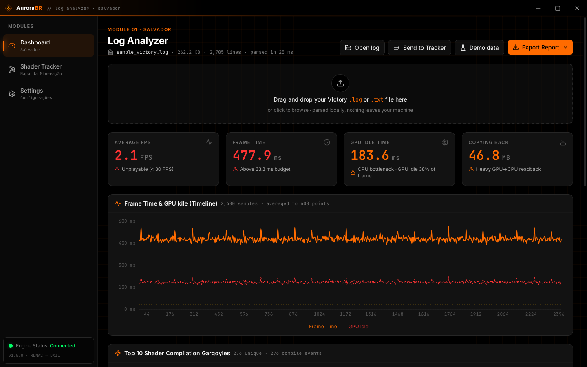
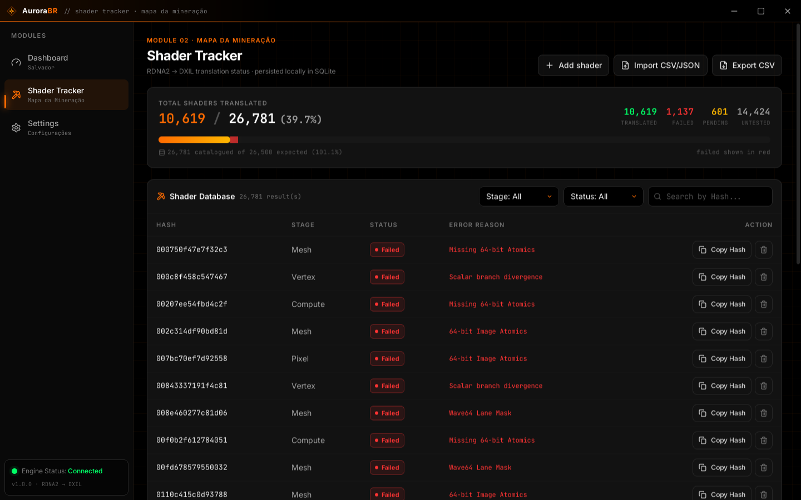
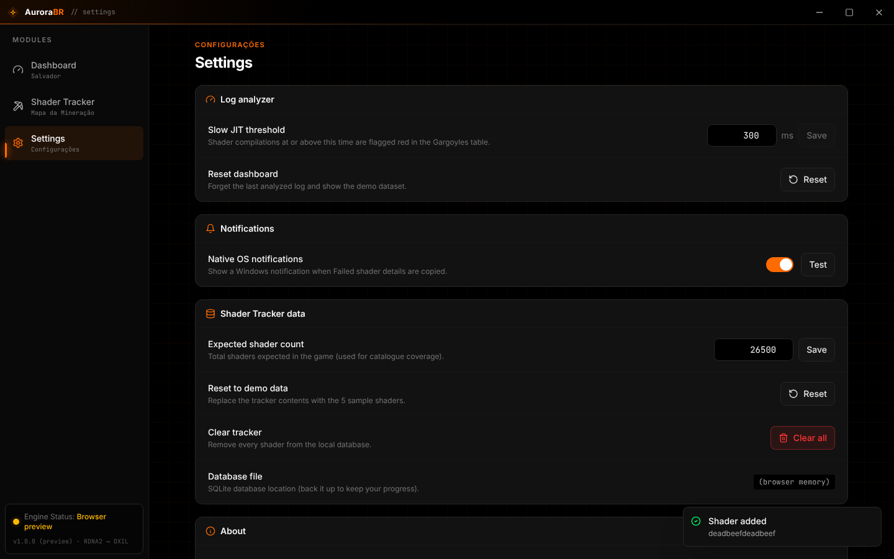

<div align="center">


# AuroraBR

**Ferramenta desktop brasileira para análise de recompilação de jogos**
Analisa logs de desempenho e acompanha a tradução de shaders **RDNA2 → DXIL**.

Windows 10 / 11 (x64) · Tauri 2 + Rust + React · 100% local, sem internet

[**⬇ Baixar o instalador**](../../releases/latest) · [Como usar](#como-usar) · [Formato de log](#formato-de-log-reconhecido) · [Compilar](#compilar-a-partir-do-código) · [Segurança](docs/SEGURANCA.md)

</div>



---

## Para que serve

Quem trabalha recompilando um jogo para outra plataforma passa muito tempo lendo logs enormes do emulador/recompilador para descobrir **por que o jogo está lento** e **quais shaders ainda não funcionam**. O AuroraBR faz isso em dois módulos:

| Módulo | Apelido | O que faz |
|---|---|---|
| **Log Analyzer** | *Salvador* | Você arrasta um log `.log`/`.txt` e ele mostra FPS médio, frame time, tempo ocioso da GPU (gargalo de CPU), volume de *copy back*, um gráfico da linha do tempo, os 10 shaders que mais demoraram para compilar e um terminal com todos os `WARN`/`ERROR`. Exporta relatório em **PDF** ou **JSON**. |
| **Shader Tracker** | *Mapa da Mineração* | Banco de dados local (SQLite) com o status de tradução de cada shader (Translated / Failed / Pending / Untested), motivo do erro, filtros, busca por hash, paginação, importação/exportação CSV/JSON e barra de progresso global. Os dados ficam salvos entre sessões. |

Tudo roda no seu computador: o app **não se conecta à internet**, não executa programas e só abre ou salva arquivos que você escolher.

## Instalação

1. Baixe o **`AuroraBR_1.0.0_x64-setup.exe`** na página de [Releases](../../releases/latest).
2. Execute. Não precisa de administrador (instala para o usuário atual).
3. Se aparecer *"O Windows protegeu o computador"* (SmartScreen), clique em **Mais informações → Executar assim mesmo**. O aviso aparece porque o instalador ainda não tem assinatura digital de código. Veja [docs/SEGURANCA.md](docs/SEGURANCA.md).
4. O app usa o **WebView2** da Microsoft, que já vem no Windows 11 e no Windows 10 atualizado. Se faltar, o instalador baixa automaticamente.

**Versão portátil:** o `AuroraBR_portable.zip` (também na Release) roda sem instalar: extraia a pasta inteira e execute `aurorabr.exe` (se houver um `WebView2Loader.dll`, ele precisa ficar junto).

Confira a integridade do download comparando o SHA-256 com o arquivo `SHA256SUMS.txt` da Release:

```powershell
Get-FileHash .\AuroraBR_1.0.0_x64-setup.exe -Algorithm SHA256
```

## Como usar

### Log Analyzer (Salvador)
1. Abra o app. Ele começa com dados de demonstração (selo **DEMO DATA**).
2. Arraste o arquivo de log para a janela, ou clique em **Open log**.
3. Veja os indicadores, o gráfico e as tabelas. Clique num hash para copiá-lo.
4. **Export Report** salva o relatório em PDF ou JSON.
5. **Send to Tracker** adiciona todos os shaders do log ao Shader Tracker.

Há um log de exemplo em [`exemplos/exemplo_victory.log`](exemplos/exemplo_victory.log).

### Shader Tracker (Mapa da Mineração)


- **Import CSV/JSON** carrega a lista de shaders da equipe (exemplo em [`exemplos/exemplo_shaders.csv`](exemplos/exemplo_shaders.csv)).
- Clique no selo de status de uma linha para mudar o status.
- Clicar numa linha **Failed** copia os detalhes do shader e mostra uma notificação do Windows.
- **Export CSV** gera um arquivo para compartilhar o progresso com a equipe (cada PC tem seu próprio banco).

### Settings


Limite de "Slow JIT" (padrão 300 ms), notificações, total esperado de shaders (padrão 26.500) e opções para resetar/limpar dados.

### Onde ficam os dados
- Banco: `%APPDATA%\br.aurora.analyzer\aurorabr.db`. Faça backup desse arquivo para guardar o progresso.
- Se o banco corromper, o app o renomeia para `*.corrupt-<data>.db` e cria outro, então sempre abre.

## Formato de log reconhecido

O parser é tolerante e procura estes padrões em qualquer linha (sem diferenciar maiúsculas/minúsculas):

| Métrica | Exemplos aceitos |
|---|---|
| FPS | `FPS: 2.1` · `fps=60` · `59.9 fps` |
| Frame time | `Frame time: 476.2 ms` · `frame_time=16ms` · `0.5 s` · `16000 us` |
| GPU idle | `GPU idle: 183.4 ms` · `gpu_idle_time=2ms` |
| Copy back | `Copying back: 46.8 MB` · `copy back: 2048 KB` |
| Compilação de shader | linha com `shader`/`compil`/`pipeline`/`jit` + hash hex de 16 dígitos + tempo em `ms`, ex.: `Shader compiled hash=4e35b816f2f91d68 stage=Mesh time=405 ms` |
| Estágio | `Mesh`, `Pixel`, `Compute`, `Vertex`, `Geometry`… ou `stage=PS`, `[CS]` |
| Nível | `WARN`, `WARNING`, `ERROR`, `ERR`, `FATAL`, `CRITICAL` |

- Codificação: UTF-8 (com ou sem BOM) e UTF-16 com BOM; bytes inválidos não travam a leitura.
- Arquivos grandes são lidos em streaming: 64 MB / 1,2 milhão de linhas em cerca de 4 s.
- Se o seu log usa outro formato, ajuste as expressões regulares em [`src-tauri/src/parser.rs`](src-tauri/src/parser.rs) (função `patterns()`).

Formato de importação do Tracker: CSV (`,` `;` ou TAB) com cabeçalho `hash,stage,status,reason`, ou JSON (lista, `{"shaderDatabase":[...]}` ou `{"shaders":[...]}`).

## Compilar a partir do código

**Requisitos (Windows):** [Node.js 20+](https://nodejs.org), [Rust](https://rustup.rs) (toolchain MSVC) e o Visual Studio Build Tools com a carga *"Desktop development with C++"*.

```bash
git clone https://github.com/voidddreaper/AURORA-BR.git
cd AURORA-BR
npm install
npm run tauri dev        # abre o app em modo desenvolvimento
npm run tauri build      # gera o instalador em src-tauri/target/release/bundle/nsis/
```

Testes:

```bash
cd src-tauri && cargo test    # 15 testes do parser e do banco de dados
```

Toda alteração enviada ao repositório é compilada e testada automaticamente no Windows pelo GitHub Actions ([`.github/workflows/build.yml`](.github/workflows/build.yml)), que guarda o instalador gerado como artefato.

## Estrutura do projeto

```
aurorabr/
├── src/                      # Interface (React + TypeScript + Tailwind)
│   ├── pages/                # Dashboard, ShaderTracker, Settings
│   ├── components/           # Barra de título, sidebar, toasts, badges
│   └── lib/                  # API para o backend, relatório PDF/JSON, configurações
├── src-tauri/                # Backend (Rust)
│   ├── src/parser.rs         # Leitura e análise dos logs
│   ├── src/db.rs             # Banco SQLite do Shader Tracker
│   ├── src/lib.rs            # Comandos expostos à interface
│   ├── capabilities/         # Permissões do app (janela, diálogos, notificação, clipboard)
│   └── tauri.conf.json       # Configuração da janela, segurança (CSP) e instalador
├── exemplos/                 # Log e CSV de exemplo
└── docs/                     # Screenshots e relatório de segurança
```

**Stack:** Tauri 2 · Rust · SQLite (rusqlite) · React 18 · TypeScript · Tailwind CSS · Recharts · Framer Motion · Lucide · jsPDF

## Segurança

O app não tem código de rede, não executa programas e a política de conteúdo bloqueia qualquer conexão externa. As dependências foram auditadas com `npm audit` e `cargo audit` (0 vulnerabilidades conhecidas na versão 1.0.0). Detalhes, hashes e como verificar: [docs/SEGURANCA.md](docs/SEGURANCA.md).
